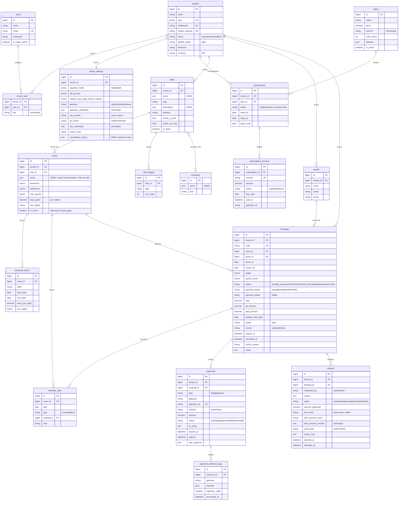
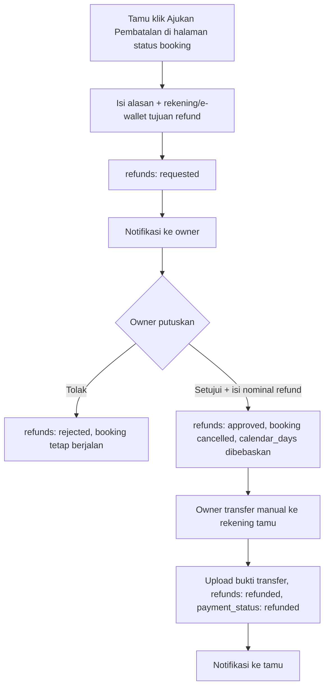
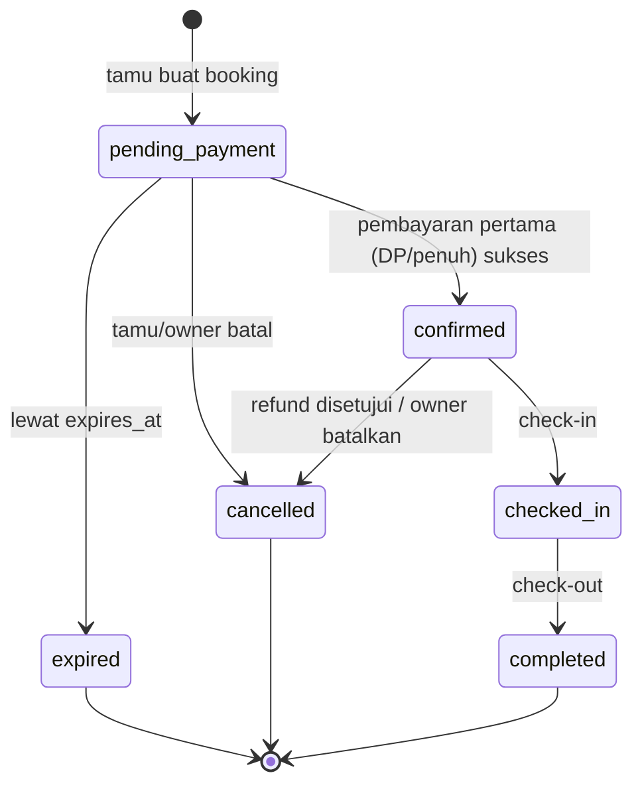
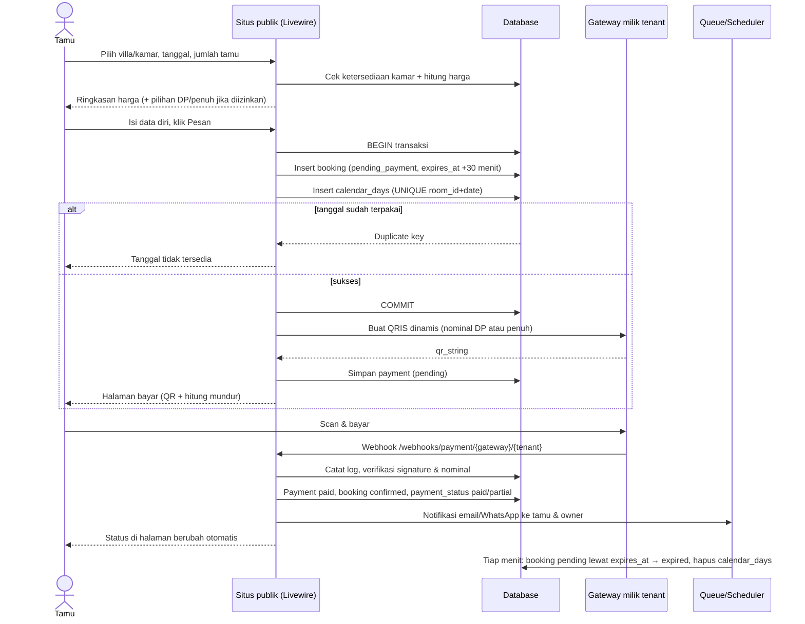

# Arsitektur Booking Villa (Multi-Tenant SaaS)

Setiap **owner villa = 1 tenant** (1 akun login) yang berlangganan. Satu tenant boleh punya **banyak villa**, dan tiap villa punya **kamar/unit** yang bisa dipesan. Platform dikelola oleh kamu (super admin).

**Stack:** Laravel 13 (PHP 8.3+) · MySQL · **Filament 5** (admin) · **Livewire 4** (situs publik) · queue & scheduler Laravel · QRIS dinamis via payment gateway · bahasa **ID/EN**.

Prinsip biar gampang maintenance:
1. Logika bisnis di **Service/Action class**, controller/Livewire tipis.
2. Gateway pembayaran dan pengirim WhatsApp dibungkus **interface**, vendor bisa diganti per tenant.
3. Anti double booking dijaga **di database** (unique key per kamar per malam).
4. Status pakai **Enum**, perubahan status hanya lewat satu service.
5. Webhook dicatat dan **idempotent**.
6. Data tenant terisolasi lewat **global scope `tenant_id`** (trait `BelongsToTenant`), jangan pernah query tanpa scope.

---

## 1. Model Multi-Tenant & Langganan

- **Satu database, kolom `tenant_id`** di semua tabel data tenant.
- **Dua panel Filament:**
  - `/platform` : super admin (kamu). Kelola tenant, paket, invoice, suspend/aktifkan.
  - `/admin` : owner villa (memakai *tenancy* bawaan Filament). Kelola villa, kamar, booking, kalender, pengaturan, refund.
- **Situs publik tiap tenant** dikenali dari subdomain: `namavilla.domainkamu.com` (domain sendiri milik kamu dipakai sebagai induk; butuh **wildcard DNS + SSL wildcard**, VPS paling mudah). Custom domain milik client bisa menyusul.
- Satu user bisa menjadi staf di beberapa tenant (tabel `tenant_user`, role `owner|staff`).

### Paket langganan (berdasarkan total kamar)
| Paket | `max_rooms` | Harga/bulan |
|---|---|---|
| Starter | 10 | Rp150.000 |
| Growth | 20 | Rp250.000 |
| Business (usulan) | 30 | Rp350.000 |

Isi tabel `plans` bisa diubah super admin; tidak ditulis mati di kode.

Aturan:
- Yang dihitung = **jumlah kamar/unit aktif di semua villa milik tenant**. Villa yang disewa utuh = 1 kamar/unit ("Seluruh villa").
- Jumlah villa tidak dibatasi.
- Saat owner menambah kamar dan melebihi `max_rooms`, sistem menolak dan menawarkan upgrade paket. Downgrade ditolak jika kamar aktif melebihi batas paket baru.
- Scheduler harian: buat invoice, kirim pengingat, beri masa tenggang, lalu **suspend** tenant yang menunggak (booking baru ditutup, data aman).
- Tagihan langganan dibayar ke **akun gateway platform (milik kamu)**, terpisah dari uang tamu. Biaya langganan sudah termasuk maintenance dan support.

### Uang tamu → langsung ke owner
Tiap tenant mengisi **kredensial gateway miliknya sendiri** (terenkripsi). Dana pembayaran tamu masuk ke rekening owner, bukan ke kamu. Webhook per tenant: `/webhooks/payment/{gateway}/{tenant}` supaya signature diverifikasi dengan kredensial tenant yang benar.

---

## 2. Database (ERD)



### Catatan desain
- **Hierarki:** `tenant → villa → kamar (rooms)`. Yang dipesan tamu adalah **kamar/unit**. Villa sewa utuh cukup punya 1 kamar ("Seluruh villa"). Foto dan fasilitas melekat di villa.
- **`calendar_days` + `UNIQUE(room_id, date)`** = kunci anti double booking. 1 kamar 1 malam = 1 baris. Dua pemesan di malam yang sama: salah satu gagal di database. Malam yang dihitung adalah `check_in` sampai sebelum `check_out`.
- Blok tanggal oleh owner = baris `type = block`. Booking batal/kadaluarsa = barisnya dihapus.
- Versi awal: **1 booking = 1 kamar**. Tamu yang ingin dua kamar membuat dua booking. Keranjang multi-kamar (`booking_items`) menyusul bila diminta client.
- **Harga dikunci di booking** (`total`, `dp_amount`) saat dibuat.
- **Status booking dan status bayar dipisah.** `status` = siklus tamu, `payment_status` = kondisi uang (`unpaid → partial → paid → refunded`).
- Satu booking bisa punya banyak `payments` (DP, pelunasan, atau QR kadaluarsa lalu dibuat ulang).
- Teks tampilan tamu (`name`, `description`, fasilitas, kebijakan pembatalan) dua bahasa (`spatie/laravel-translatable`).
- Kredensial gateway/WA dan nomor rekening refund **terenkripsi** (`encrypted` cast), tidak boleh muncul di log.
- Soft delete untuk `villas`, `rooms`, `guests`, `tenants`.
- Index: `bookings(tenant_id, status, expires_at)`, `bookings(room_id, check_in, check_out)`, `payments(gateway_ref)`, `rooms(tenant_id, is_active)`.

### Menyusul (belum dibuat)
`booking_items` (multi-kamar), `coupons`, `reviews`, `ota_sync` (iCal), `activity_logs`, `notification_logs`.

---

## 3. Pembayaran oleh Tamu (full / DP, diatur owner)

- `payment_mode = full` : wajib bayar penuh.
- `payment_mode = dp` : bayar DP sebesar `dp_percent`.
- `payment_mode = both` : tamu memilih sendiri saat checkout.

Aturan DP:
1. DP diterima → booking `confirmed`, `payment_status = partial`, kamar terkunci.
2. Sisa tagihan jatuh tempo `balance_due_days_before_checkin` hari sebelum check-in. Dibayar lewat QRIS baru (`payments.type = balance`) atau dicatat manual owner (tunai/transfer).
3. Scheduler mengirim pengingat pelunasan. Jika lewat jatuh tempo, owner diberi tahu untuk menindaklanjuti atau membatalkan (tidak otomatis batal).

## 3b. Pembatalan & Refund (owner yang memutuskan)



- Uang **tidak kembali otomatis** lewat QRIS. Owner transfer manual, sistem mencatat nominal, rekening tujuan, dan bukti transfer.
- Kebijakan pembatalan (mis. refund 100% jika H-7) ditulis owner di `cancellation_policy` dan ditampilkan saat checkout. Penentuan nominal tetap oleh owner.
- Owner juga bisa membatalkan booking sendiri dari admin (`requested_by = owner`).
- Refund otomatis via API gateway: opsional, menyusul jika gateway mendukung.

---

## 4. Status Booking



---

## 5. Alur Booking + QRIS



---

## 6. Notifikasi WhatsApp

Kirim otomatis **tidak bisa hanya dengan nomor owner**: harus ada akun/API pengirim. Interface `WhatsAppSender` dengan driver per tenant (`tenant_settings.wa_driver`):

| Driver | Cara kerja | Catatan |
|---|---|---|
| `link` (default) | Tombol/link `wa.me` untuk tamu menghubungi owner; notifikasi ke owner lewat **email** | Gratis, tanpa API, tanpa risiko |
| `fonnte` (pihak ketiga) | Owner scan QR nomor WA-nya di dashboard Fonnte, sistem kirim lewat API Fonnte | Murah, **tidak resmi**, nomor berisiko diblokir; owner berlangganan Fonnte sendiri |
| `meta` | WhatsApp Business Cloud API resmi | Stabil, perlu verifikasi bisnis, pesan pakai template, ada biaya per percakapan |

Mulai dengan `link` + email, tambah driver `fonnte` di fase notifikasi.

---

## 7. Bahasa ID/EN

- `lang/id` dan `lang/en` untuk antarmuka (Livewire, email, Filament).
- Konten villa/kamar dua bahasa lewat kolom JSON.
- Pilihan bahasa disimpan di sesi (`/lang/id`, `/lang/en`); bahasa awal mengikuti `tenants.default_locale`. URL berprefix `/id` dan `/en` dipertimbangkan saat halaman publik dibuat (fase 3).
- `bookings.locale` menyimpan bahasa tamu supaya email/WA dikirim dalam bahasa yang sama.

---

## 8. Struktur Folder Laravel

```
app/
├── Enums/                  # BookingStatus, PaymentStatus, PaymentOption, TenantStatus, RefundStatus
├── Models/
│   └── Concerns/BelongsToTenant.php     # global scope tenant_id
├── Contracts/
│   ├── PaymentGateway.php               # createQris(), verifyWebhook(), parseWebhook()
│   └── WhatsAppSender.php
├── Services/
│   ├── AvailabilityService.php          # cek & kunci tanggal per kamar
│   ├── PricingService.php
│   ├── BookingService.php               # buat/batal/konfirmasi, hitung DP
│   ├── PaymentService.php
│   ├── RefundService.php                # ajukan, setujui, tandai refunded
│   ├── SubscriptionService.php          # invoice, suspend, cek kuota kamar
│   ├── Payment/ (IpaymuGateway, ManualGateway, FakeGateway, GatewayFactory)
│   └── Whatsapp/ (LinkSender, FonnteSender, MetaCloudSender)
├── Filament/
│   ├── Platform/            # panel super admin
│   └── Admin/               # panel owner (tenancy)
├── Livewire/Public/         # VillaList, VillaDetail, BookingForm, PayPage, BookingStatus, RefundRequestForm
├── Http/
│   ├── Controllers/Webhook/PaymentWebhookController.php
│   └── Middleware/ (ResolveTenant, SetLocale, EnsureTenantActive)
├── Jobs/                    # SendBookingNotification, ...
├── Console/Commands/ (ExpirePendingBookings, SendBalanceReminders, ProcessSubscriptions)
└── Notifications/
lang/ (id, en)
config/booking.php
database/ (migrations, seeders [PlanSeeder], factories)
tests/ (Feature, Unit)
```

---

## 9. Keamanan & Keandalan

- Verifikasi signature dan nominal webhook, simpan semua callback di `payment_webhook_logs`, proses idempotent.
- Global scope tenant + **test otomatis** bahwa tenant A tidak bisa melihat data tenant B.
- Perubahan booking + `calendar_days` dalam **DB transaction**.
- Rate limit endpoint booking, refund, dan webhook. Validasi tanggal, `min_nights`, `max_guests`.
- Kredensial dan nomor rekening terenkripsi, `.env` tidak masuk Git.
- Tenant `suspended` tidak bisa menerima booking baru, booking lama tetap berjalan.
- Backup database harian di produksi.

---

## 10. Fase Pengerjaan

| Fase | Isi | Hasil |
|---|---|---|
| 0 | Setup Laravel, Filament 2 panel, tenancy (scope, `ResolveTenant`), i18n dasar, `PlanSeeder` | Kerangka multi-tenant siap |
| 1 | Villa + kamar (CRUD, foto, fasilitas) dengan cek kuota paket | Owner bisa kelola villa & kamar |
| 2 | Ketersediaan, harga musiman, kalender, blok tanggal | Cek tanggal & harga akurat |
| 3 | Situs publik Livewire + booking + pembayaran manual + opsi DP | Alur pesan end-to-end (bisa didemokan) |
| 4 | Gateway QRIS per tenant + webhook + auto-expire + pelunasan DP | Pembayaran otomatis |
| 5 | Pembatalan & refund + notifikasi email/WhatsApp (`link`, lalu `fonnte`) | Kabar otomatis, refund tercatat |
| 6 | Langganan: invoice, suspend, panel platform | Model SaaS berjalan |
| 7 | Laporan, polishing, deploy (VPS, wildcard SSL) | Siap untuk client pertama |

Untuk client pertama, langganan bisa dicatat manual dulu (fase 6 menyusul) supaya cepat go-live.

---

## 11. Keputusan yang Sudah Diambil

- Multi-tenant SaaS, 1 akun owner bisa punya banyak villa; kuota paket dihitung dari total kamar.
- Paket: 10 kamar Rp150.000, 20 kamar Rp250.000, 30 kamar Rp350.000 (usulan), per bulan.
- Admin Filament, frontend Livewire, bahasa ID/EN.
- Pembayaran tamu: full/DP diatur owner; uang masuk ke gateway milik owner.
- Domain induk milik sendiri, tenant lewat subdomain.
- Refund: owner yang menyetujui dan transfer manual.
- Notifikasi: `link` + email dulu, lalu Fonnte.

## 12. Pertanyaan Terbuka

1. Harga paket di atas 30 kamar: lanjut +Rp100.000 per 10 kamar, atau harga khusus?
2. Ada masa **trial gratis** untuk owner baru? Berapa hari?
3. Langganan tahunan (diskon) diperlukan di awal?

---

## Catatan implementasi fase 4 (gateway QRIS)

- Kontrak `App\Contracts\PaymentGateway` (`createQris`, `verifyWebhook`, `parseWebhook`). Driver tersedia: `FakeGateway` (pengembangan/tes, tidak aktif di production). Driver gateway nyata (iPaymu/Duitku) ditambahkan di `App\Support\Payment\GatewayFactory` setelah ada akun sandbox untuk menguji format tanda tangan dan callback-nya.
- Webhook: `POST /webhooks/payment/{gateway}/{slug-tenant}`, di luar grup `web` (tanpa sesi/CSRF), dibatasi 120 permintaan/menit. Selalu dicatat di `payment_webhook_logs`; tanda tangan diverifikasi dengan kredensial tenant; nominal harus sama dengan tagihan; idempotent.
- Gateway gagal dihubungi -> tagihan tetap transfer manual. Pembayaran masuk setelah booking kedaluwarsa/batal -> dicatat `late_payment` (booking tidak dihidupkan), owner menindaklanjuti (refund di fase 5).
- Pelunasan DP lewat QRIS: tamu menekan "Bayar pelunasan" di halaman status booking; tagihan `balance` kedaluwarsa otomatis lewat `bookings:expire`.

---

## Catatan implementasi fase 5 (pembatalan, refund, notifikasi)

- **Tingkat refund per tenant** (`tenant_settings.refund_tiers`, mis. H-7 100%, H-3 50%): dipakai tingkat dengan H- terbesar yang terpenuhi; di luar semua tingkat 0%. `null` = bawaan (7/100, 3/50), `[]` = tanpa refund. Hanya **saran**: owner selalu bisa menetapkan nominal sendiri (0 sampai total yang sudah dibayar).
- **Alur**: tamu mengajukan (alasan + rekening tujuan, nomor rekening terenkripsi) -> owner setujui (booking dibatalkan, tanggal bebas) / tolak -> owner transfer manual lalu tandai selesai (bukti transfer). Refund penuh menandai pembayaran `refunded`. Owner juga bisa membatalkan booking sendiri sekaligus menetapkan refund.
- **Email** (`App\Support\Notifier`, `App\Mail\SimpleMail`): booking dibuat, pembayaran diterima/terkonfirmasi, dibatalkan, pengajuan refund (ke owner), keputusan refund, refund ditransfer, pengingat pelunasan (`bookings:remind-balance`, harian 09:00, sekali per booking). Bahasa mengikuti bahasa booking. Kegagalan kirim hanya dicatat di log dan tidak menggagalkan booking/pembayaran. Email owner memakai `tenant_settings.notify_email`.
- **SMTP produksi** (isi di `.env`, contoh Hostinger): `MAIL_MAILER=smtp`, `MAIL_HOST=smtp.hostinger.com`, `MAIL_PORT=465`, `MAIL_SCHEME=smtps`, `MAIL_USERNAME=<email@domainanda>`, `MAIL_PASSWORD=<sandi email>`, `MAIL_FROM_ADDRESS=<email@domainanda>`. Lokal: `MAIL_MAILER=log` (email ditulis ke `storage/logs/laravel.log`).
- WhatsApp otomatis (Fonnte/Meta) belum; saat ini tombol `wa.me` di halaman status booking.
